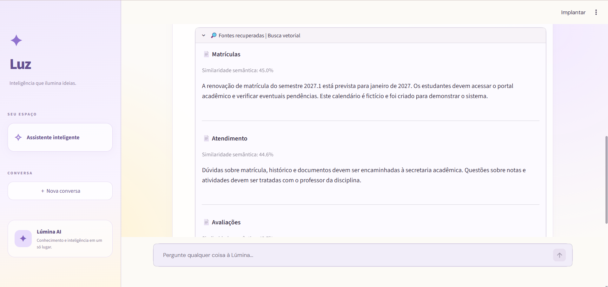

<div align="center">

# ✦ Luz ✦
### Assistente Virtual com Inteligência Artificial e RAG

**Um assistente acadêmico que combina inteligência artificial, busca semântica e banco de dados vetorial.**

<br>


<br>

**[🎬 Assistir à demonstração](https://drive.google.com/file/d/1gfw1qtXQEvetRTvU8UAAM5m3P1nGp21b/view?usp=sharing)**

</div>

---

## ✨ Sobre o projeto

O **Luz** é um assistente virtual desenvolvido para responder perguntas utilizando inteligência artificial e informações armazenadas em um banco de dados vetorial.

A aplicação foi criada em Python, com interface desenvolvida no Streamlit, integração com o Google Gemini e armazenamento de documentos acadêmicos no Supabase.

O principal diferencial do projeto é a utilização da arquitetura **RAG (Retrieval-Augmented Generation)**, que permite recuperar informações relevantes antes de gerar uma resposta.

O assistente também consegue responder perguntas gerais, funcionando como uma aplicação que combina conversação com inteligência artificial e recuperação de conhecimento.

> 💡 **Proposta:** desenvolver um assistente acadêmico capaz de utilizar busca semântica e inteligência artificial generativa para facilitar o acesso a informações.

---

## 🖥️ Conheça o Luz

A interface foi desenvolvida com uma identidade visual leve, utilizando tons suaves e elementos simples para tornar a experiência mais agradável.

### ✦ Tela inicial

<div align="center">
  
</div>

### ✦ Exemplo de pergunta

<div align="center">
  
</div>

### ✦ Resposta gerada pelo assistente

<div align="center">
  
</div>

### ✦ Recuperação de documentos

<div align="center">
  
</div>

A aplicação permite visualizar os documentos recuperados e seus valores de similaridade, demonstrando como a busca vetorial contribui para a construção das respostas.

---

## 🧠 Como funciona?

O sistema possui dois tipos de atendimento.

**💬 Conversação geral**

Quando o usuário faz uma pergunta que não depende da base acadêmica, o Luz utiliza o Google Gemini para gerar a resposta.

**📚 Consulta acadêmica com RAG**

Quando a pergunta está relacionada aos conteúdos acadêmicos, o sistema consulta o banco de dados vetorial e recupera documentos relevantes antes de gerar a resposta.

### ✦ Etapas da arquitetura RAG

```text
        👤 Usuário
             │
             ▼
      Pergunta enviada
             │
             ▼
     Geração do embedding
       SentenceTransformers
             │
             ▼
      Busca semântica
      Supabase + pgvector
             │
             ▼
     Documentos relevantes
             │
             ▼
        Google Gemini
             │
             ▼
      Resposta ao usuário
```

O processo utiliza embeddings para representar o significado dos textos em vetores numéricos, permitindo recuperar informações semanticamente relacionadas à pergunta.

---

## 🛠️ Tecnologias utilizadas

| Tecnologia | Utilização |
|:---|:---|
| 🐍 **Python** | Desenvolvimento da aplicação |
| 🎨 **Streamlit** | Interface web |
| 🗄️ **Supabase** | Armazenamento dos documentos |
| 🐘 **PostgreSQL** | Banco de dados |
| 🔎 **pgvector** | Busca por similaridade vetorial |
| 🧠 **SentenceTransformers** | Geração de embeddings |
| 🤖 **Google Gemini** | Geração de respostas |
| ☁️ **Google AI Studio** | Acesso à API do Gemini |

### Modelo de embeddings

Foi utilizado o modelo **`all-MiniLM-L6-v2`**, que transforma textos em vetores de 384 dimensões.

Esses vetores são armazenados no banco de dados e utilizados para comparar semanticamente as perguntas com os documentos disponíveis.

---

## 📚 Base de conhecimento

Para demonstrar o funcionamento do RAG, foi criada uma base fictícia com seis documentos relacionados ao ambiente acadêmico.

| Documento | Conteúdo |
|:---|:---|
| 📋 Matrículas | Informações sobre matrícula e rematrícula |
| 📝 Avaliações | Orientações sobre avaliações acadêmicas |
| 📖 Biblioteca | Informações sobre serviços da biblioteca |
| 📄 Documentos | Solicitação de documentos acadêmicos |
| 🎓 Atendimento | Orientações sobre atendimento ao estudante |
| 💜 Bolsas e benefícios | Informações sobre benefícios estudantis |

Os conteúdos estão disponíveis no arquivo `docs/conhecimento.txt`.

**Observação:** os documentos são fictícios e foram criados exclusivamente para fins acadêmicos e demonstrativos.

---

## 🗄️ Banco de dados vetorial

O banco de dados foi implementado no **Supabase**, utilizando PostgreSQL e a extensão pgvector.

A tabela `documentos_lumina` armazena os documentos e seus respectivos embeddings.

A função SQL `buscar_documentos_lumina` realiza a recuperação de informações por similaridade vetorial.

O processo permite encontrar documentos relacionados ao significado da pergunta, mesmo quando os termos utilizados são diferentes.

O script de configuração do banco está disponível em:

`docs/banco.sql`

---

## 🚀 Como executar o projeto

### 1. Clonar o repositório

```bash
git clone https://github.com/RonaldSE414/luz-assistente-ia.git
cd luz-assistente-ia
```

### 2. Criar o ambiente virtual

```bash
python -m venv .venv
```

No Windows PowerShell:

```powershell
.\.venv\Scripts\Activate.ps1
```

### 3. Instalar as dependências

```bash
pip install -r requirements.txt
```

### 4. Configurar o Supabase

No painel do Supabase, acesse o **SQL Editor** e execute o conteúdo do arquivo `docs/banco.sql`.

### 5. Configurar as variáveis de ambiente

Crie o arquivo `.env` com base no `.env.example`.

No PowerShell:

```powershell
Copy-Item .env.example .env
```

Preencha as variáveis com as credenciais do seu projeto Supabase e a chave de API do Gemini, seguindo os nomes definidos no `.env.example`.

> 🔒 O arquivo `.env` contém informações privadas e não deve ser publicado no GitHub.

### 6. Carregar os documentos

```bash
python carregar_dados.py
```

Esse comando gera os embeddings e armazena os documentos no banco de dados.

### 7. Executar o assistente

```bash
streamlit run app.py
```

Acesse o endereço apresentado no terminal, normalmente:

**http://localhost:8501**

---

## 🧪 Testes realizados

Durante o desenvolvimento, foram realizados testes para verificar o funcionamento das principais funcionalidades.

| Teste | Funcionalidade verificada |
|:---|:---|
| 💬 Pergunta geral | Geração de resposta pelo Gemini |
| 📚 Pergunta acadêmica | Consulta à base de conhecimento |
| 🔎 Busca semântica | Recuperação de documentos relevantes |
| 🧠 Geração com RAG | Resposta utilizando o contexto recuperado |
| 📊 Visualização das fontes | Exibição de documentos e similaridades |

Os testes permitiram observar o funcionamento da integração entre interface, modelo de embeddings, banco vetorial e inteligência artificial generativa.

---

## 📂 Estrutura do projeto

```text
luz-assistente-ia/
│
├── app.py
├── rag.py
├── database.py
├── carregar_dados.py
├── requirements.txt
├── README.md
├── .env.example
├── .gitignore
│
├── .streamlit/
│   └── config.toml
│
├── assets/
│   └── style.css
│
└── docs/
    ├── banco.sql
    ├── conhecimento.txt
    └── imagens/
        ├── tela-inicial.png
        ├── consulta.png
        ├── resposta-rag.png
        └── fontes-vetoriais.png
```

---

## ⚠️ Limitações

O projeto utiliza uma base de conhecimento fictícia e reduzida, composta por seis documentos acadêmicos.

A identificação das perguntas relacionadas ao conteúdo institucional depende de regras implementadas no código.

Além disso, a geração de respostas depende da disponibilidade da API do Google Gemini.

O sistema foi desenvolvido para fins educacionais, com foco na demonstração da arquitetura RAG e da busca semântica.

---

## 🎥 Demonstração em vídeo

O vídeo apresenta a interface do Luz e demonstra o funcionamento do assistente com perguntas e recuperação de documentos.

<div align="center">

### ▶️ [Clique aqui para assistir à demonstração](https://drive.google.com/file/d/1gfw1qtXQEvetRTvU8UAAM5m3P1nGp21b/view?usp=sharing)

</div>

---

## 👨‍💻 Desenvolvimento

**Aluno:** Ronald Machado Guimarães de Sousa

**Professor:** Anderson Soares

**Disciplina:** Projeto de Banco de Dados

**Tema:** Banco de Dados Vetorial, Busca Semântica e RAG

---

<div align="center">

### ✦ Luz ✦

*Inteligência artificial e conhecimento conectados em um só lugar.*

**Projeto acadêmico — 2026**

⭐

</div>
