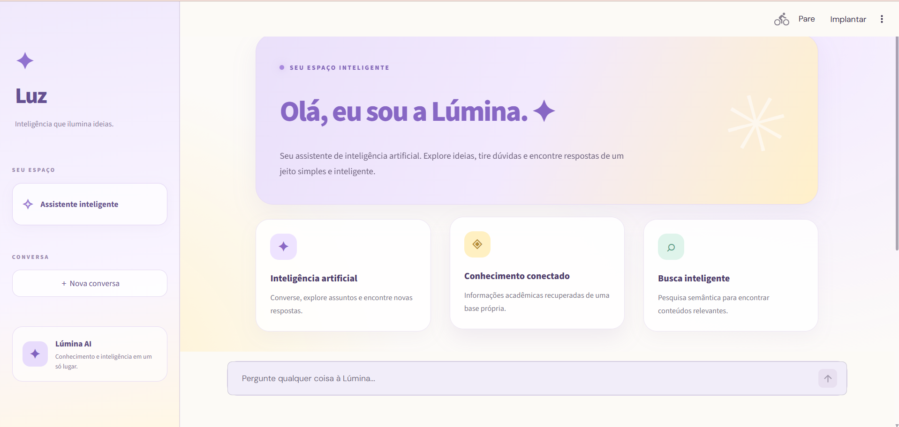
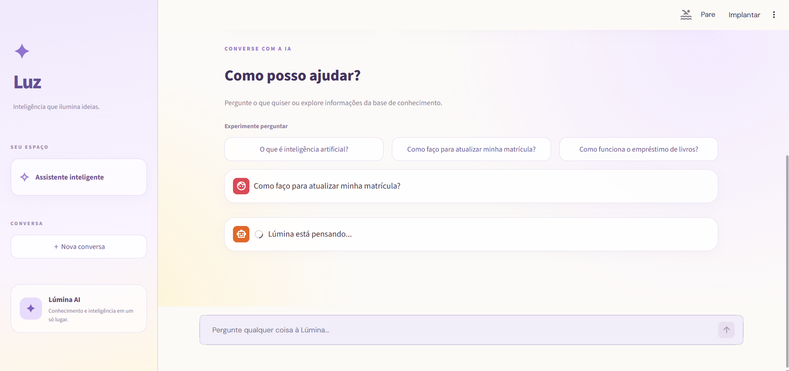
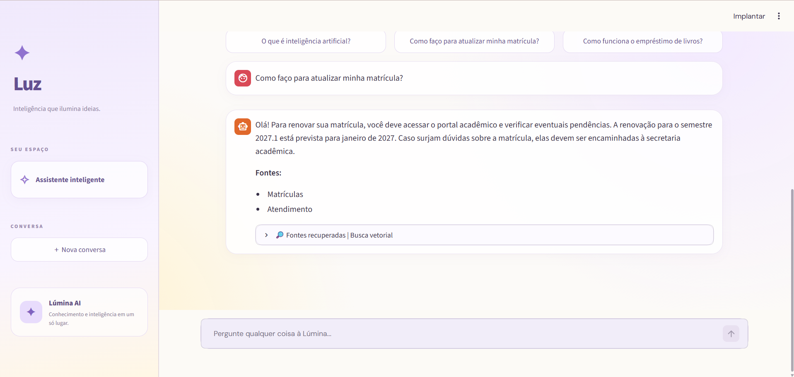

<div align="center">

# ✦ Luz

### Assistente Virtual com Inteligência Artificial e RAG

Projeto acadêmico desenvolvido com Python, Streamlit, Supabase e Google Gemini.


</div>

---


## Sobre o projeto

O **Luz** é um assistente virtual desenvolvido para auxiliar estudantes na consulta de informações acadêmicas, utilizando inteligência artificial e documentos armazenados em um banco de dados vetorial.

A aplicação foi construída em Python, com interface desenvolvida no Streamlit, integração com o Google Gemini e armazenamento de documentos acadêmicos no Supabase.

O projeto utiliza a arquitetura **RAG (Retrieval-Augmented Generation)**, que permite recuperar informações relevantes da base de conhecimento acadêmica antes de gerar uma resposta. Dessa forma, o assistente pode responder perguntas relacionadas a matrículas, avaliações, biblioteca, documentos acadêmicos e bolsas estudantis, utilizando os conteúdos cadastrados no banco de dados.

Além das consultas acadêmicas, o assistente também permite realizar perguntas gerais utilizando o Gemini.

Para demonstrar o funcionamento do sistema, foi utilizada uma base de conhecimento fictícia, desenvolvida exclusivamente para fins acadêmicos.


## Tecnologias utilizadas

| Tecnologia | Finalidade |
|---|---|
| Python | Desenvolvimento da aplicação |
| Streamlit | Interface web |
| Supabase | Armazenamento dos documentos |
| PostgreSQL | Banco de dados relacional |
| pgvector | Busca por similaridade vetorial |
| SentenceTransformers | Geração de embeddings |
| all-MiniLM-L6-v2 | Modelo de embeddings com 384 dimensões |
| Google Gemini | Geração de respostas |

## Arquitetura e funcionamento

O sistema trabalha com dois tipos de consulta.

**Perguntas gerais:** são respondidas pelo Google Gemini, sem necessidade de consultar a base de conhecimento acadêmica.

**Perguntas acadêmicas:** utilizam a arquitetura RAG, recuperando documentos relevantes antes da geração da resposta.

### Fluxo do RAG

```text
Pergunta do usuário
        |
        v
Geração do embedding
  SentenceTransformers
        |
        v
Busca vetorial no Supabase
        |
        v
Recuperação de documentos
        |
        v
Envio do contexto ao Gemini
        |
        v
Resposta ao usuário
```

O modelo `all-MiniLM-L6-v2` transforma a pergunta em um vetor numérico. Esse vetor é comparado aos embeddings armazenados no banco de dados para identificar documentos semanticamente relacionados.

Os conteúdos recuperados são utilizados como contexto pelo Gemini para gerar a resposta.

## Banco de dados e base de conhecimento

O banco de dados foi implementado no Supabase, utilizando PostgreSQL e a extensão pgvector.

A tabela `documentos_lumina` armazena os documentos e seus respectivos embeddings. A função SQL `buscar_documentos_lumina` realiza a recuperação de documentos por similaridade vetorial.

O script de configuração está disponível em `docs/banco.sql`.

Para demonstrar o funcionamento do sistema, foi criada uma base fictícia com seis documentos acadêmicos:

- Matrículas e rematrículas;
- Avaliações acadêmicas;
- Biblioteca;
- Documentos acadêmicos;
- Atendimento ao estudante;
- Bolsas e benefícios.

Os conteúdos estão disponíveis em `docs/conhecimento.txt` e são carregados no banco pelo script `carregar_dados.py`.

Os dados são fictícios e foram utilizados exclusivamente para fins acadêmicos.

## Interface e demonstração

A interface foi desenvolvida com Streamlit, permitindo realizar perguntas, visualizar as respostas e consultar os documentos recuperados durante as buscas acadêmicas.

### Tela inicial

<div align="center">
  
</div>

### Exemplo de consulta

<div align="center">
  
</div>

### Resposta utilizando RAG

<div align="center">
  
</div>

### Documentos recuperados

<div align="center">
  
</div>

Os valores de similaridade exibidos representam a proximidade entre os embeddings da pergunta e dos documentos recuperados, não uma medida de certeza da resposta.

### Vídeo demonstrativo do sistema

Demonstração da interface, das consultas acadêmicas e da recuperação de documentos com RAG.

**[Assistir à demonstração no Google Drive](https://drive.google.com/file/d/1gfw1qtXQEvetRTvU8UAAM5m3P1nGp21b/view?usp=sharing)**

## Como executar o projeto

### 1. Clonar o repositório

```bash
git clone https://github.com/RonaldSE414/luz-assistente-ia.git
cd luz-assistente-ia
```

### 2. Criar e ativar o ambiente virtual

```powershell
python -m venv .venv
.\.venv\Scripts\Activate.ps1
```

### 3. Instalar as dependências

```bash
pip install -r requirements.txt
```

### 4. Configurar o Supabase

No SQL Editor do Supabase, execute o conteúdo do arquivo `docs/banco.sql`.

### 5. Configurar as variáveis de ambiente

Crie o arquivo `.env` a partir do modelo disponibilizado no projeto:

```powershell
Copy-Item .env.example .env
```

Preencha as variáveis com as credenciais do Supabase e a chave de API do Google Gemini, seguindo o arquivo `.env.example`.

O arquivo `.env` está incluído no `.gitignore` para evitar a publicação das credenciais.

### 6. Carregar os documentos

```bash
python carregar_dados.py
```

Esse comando gera os embeddings e armazena os documentos no banco de dados.

### 7. Iniciar a aplicação

```bash
streamlit run app.py
```

A interface será disponibilizada no endereço informado pelo Streamlit, normalmente `http://localhost:8501`.

## Estrutura do projeto

```text
luz-assistente-ia/
│
├── app.py
├── rag.py
├── database.py
├── carregar_dados.py
├── requirements.txt
├── README.md
├── .env.example
├── .gitignore
│
├── .streamlit/
│   └── config.toml
│
├── assets/
│   └── style.css
│
└── docs/
    ├── banco.sql
    ├── conhecimento.txt
    └── imagens/
        ├── tela-inicial.png
        ├── consulta.png
        ├── resposta-rag.png
        └── fontes-vetoriais.png
```

## Testes realizados

Foram realizados testes com perguntas gerais e consultas relacionadas à base acadêmica, verificando a integração entre o Gemini, a busca vetorial e a interface.

Entre as funcionalidades testadas estão:

- Geração de respostas para perguntas gerais;
- Recuperação de documentos acadêmicos;
- Busca semântica utilizando embeddings;
- Geração de respostas com contexto recuperado;
- Exibição das fontes e dos valores de similaridade.

## Limitações

O projeto utiliza uma base de conhecimento reduzida e fictícia, composta por seis documentos acadêmicos.

A identificação de perguntas acadêmicas depende de regras implementadas no código, e a geração de respostas está sujeita à disponibilidade da API do Gemini.

O sistema foi desenvolvido para fins educacionais e demonstra o funcionamento de uma aplicação que integra banco de dados vetorial e inteligência artificial generativa.

---

## Informações acadêmicas

**Aluno:** Ronald Machado Guimarães de Sousa  
**Professor:** Anderson Soares  
**Disciplina:** Projeto de Banco de Dados  
**Ano:** 2026

<div align="center">

**✦ Luz — Assistente Virtual com IA e RAG**

</div>
